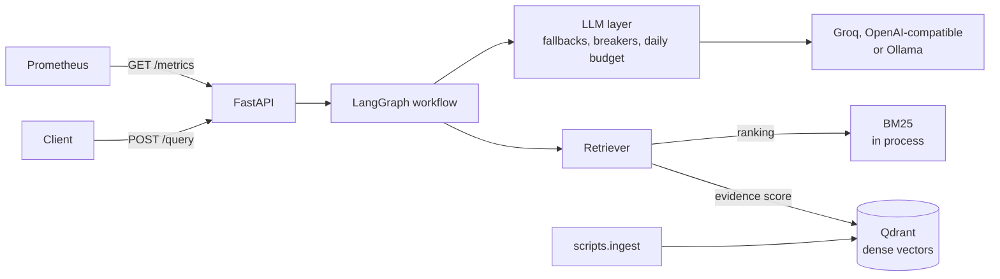
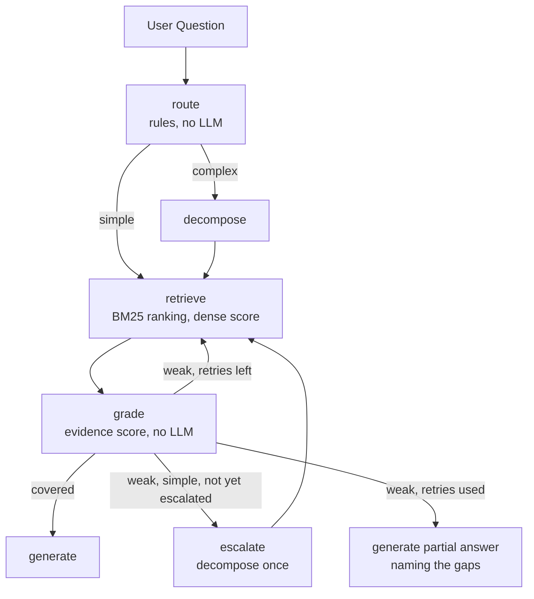

# Agentic RAG System

Question answering over the GutenQA dataset (36,917 passages from Gutenberg books).
Every answer comes from retrieved passages and carries checked citations. Built with
LlamaIndex, LangChain, LangGraph, FastAPI and Qdrant.


## Architecture



## How a question is answered



Each query runs both BM25 and a dense vector search. On the default `laptop` profile BM25
orders the passages, while the dense similarity score decides whether the evidence is
strong enough. The `server` profile fuses the two lists with Reciprocal Rank Fusion and
adds a reranker. Citations are checked against the retrieved passages, and the `grounded`
field in the response reports the result.

BM25 is the default because it won on 300 labeled questions with `all-MiniLM-L6-v2`:

| Method | Correct passage first | In top 3 | In top 8 |
|---|---|---|---|
| BM25 only | 55.0% | 68.3% | 74.7% |
| Hybrid RRF | 35.0% | 61.7% | 74.7% |
| Hybrid RRF + reranker | 59.3% | 68.3% | 74.7% |
| Dense only | 28.3% | 39.3% | 48.3% |

A simple question uses one LLM call. A comparison, or a simple question escalated after
weak evidence, uses two. Provider retries can add attempts, up to six per query. If no
LLM is available or the daily budget is spent, the service quotes the retrieved passages
with citations. If no permitted passage is found, it refuses to answer.

## Quick start

Requires Python 3.12+. Download `GutenQA.parquet`, `gutenqa_chunks.parquet` and
`questions.parquet` from HuggingFace into `data/`, then:

```bash
python -m venv .venv && source .venv/bin/activate
pip install -e .
cp .env.example .env    # add GROQ_API_KEY
```

Set `EMBEDDING_LOCAL_FILES_ONLY=false` in `.env` for the first ingest so the embedding
model can download, then set it back to `true`.

```bash
python -m scripts.ingest --path data/gutenqa_chunks.parquet
python -m scripts.ask "Where did Phileas Fogg live?"
```

To serve the API (stop other processes first, since only one can open the local index):

```bash
python -m uvicorn src.api.main:app --host 127.0.0.1 --port 8000 --workers 1
curl -X POST http://localhost:8000/query -H "Content-Type: application/json" \
  -d '{"question":"Where did Phileas Fogg live?"}'
```

`POST /query` returns `answer`, `route`, `grounded`, `citations`, `index_version`,
`answer_status` and `fallback`. `GET /health/ready` returns 200 once the index is ready.

In Windows `cmd`, put the request on one line and escape the JSON quotes. The
`Invoke-RestMethod` commands in [docs/running.md](./docs/running.md) only work in PowerShell.

```bat
curl -X POST http://127.0.0.1:8000/query -H "Content-Type: application/json" -d "{\"question\": \"Where did Phileas Fogg live?\"}"
```

To run with Docker instead:

```bash
docker compose up -d qdrant
EMBEDDING_LOCAL_FILES_ONLY=false docker compose run --rm ingest
docker compose up -d api
```

## Vector storage

An empty `QDRANT_URL` uses embedded Qdrant in `.cache/qdrant`, which needs no server.
Only one process can open it at a time. Because this corpus is over 20,000 points,
Qdrant prints a `Local mode is not recommended` warning, which concerns performance and
does not affect answers.

To keep running Python locally against a Qdrant server, add
`QDRANT_URL=http://127.0.0.1:6333` to `.env`, then run:

```bash
docker compose up -d qdrant
python -m scripts.ingest --path data/gutenqa_chunks.parquet
```

The ingest reuses cached embeddings, so unchanged chunks aren't embedded again.

## Configuration

All settings are documented in [.env.example](./.env.example). The main ones are:

- `LLM_PROVIDER`: `groq` (default), `openai` or `ollama`.
- `LLM_FALLBACK_CHAIN`, `LLM_DAILY_TOKEN_BUDGET`: backup models and the daily budget.
- `PROFILE`: `laptop` (default, for 8 GB CPU-only machines) or `server`.
- `RETRIEVAL_RANKING`: `bm25` (the `laptop` default) or `rrf` (the `server` default).
- `QDRANT_URL`: use a Qdrant server. Empty means embedded local storage.
- `REQUIRE_AUTH`, `API_KEY`: require a `Bearer` token. This is for development only.

## Monitoring

`GET /metrics` exposes Prometheus metrics. Set `LANGFUSE_ENABLED=true` to trace each
query. The `query` entry then sends the question and answer to Langfuse, while LLM
entries hold only text lengths. Set `LANGFUSE_CAPTURE_QUERY_TEXT=false` for shared
demos. See [docs/running.md](./docs/running.md).

## Development

```bash
pip install -e '.[dev]'
ruff check src tests && mypy src && pytest -q
python -m src.evaluation.run_eval --limit 10 --max-workers 1    # RAGAS smoke test
python -m scripts.calibrate_evidence --sample 300               # retrieval, no LLM calls
```